# MyPiano

A free piano game for kids that runs in the browser. Notes scroll across a grand staff, the kid plays them, and a cartoon coach cheers them on. It listens to a **real piano through the microphone**, and it also works with a **USB-MIDI keyboard** or the **on-screen keys**.

**▶ Play now: [mypiano.srichakram.in](https://mypiano.srichakram.in)**. Nothing to install.

> This repo holds only the built website that GitHub Pages serves. The source code, setup steps and license are in **[SriharshaShesham/My-Piano](https://github.com/SriharshaShesham/My-Piano)**. Open issues and pull requests there.

## Screenshots

<b>Browse all screenshots</b>

 

| | | |
|---|---|---|
| 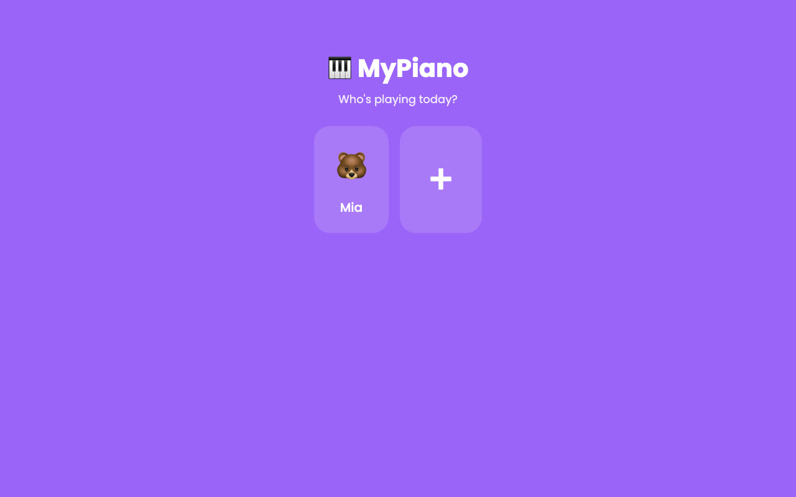 Who's playing? | 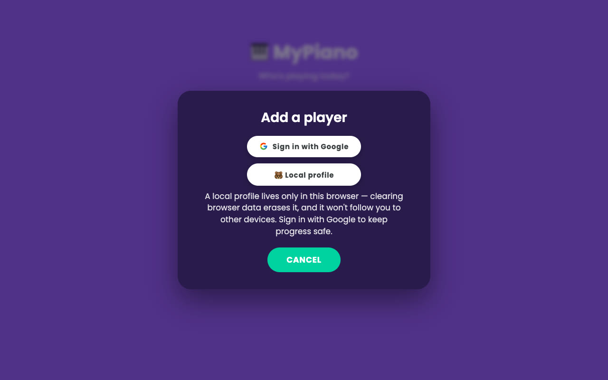 Add a player | 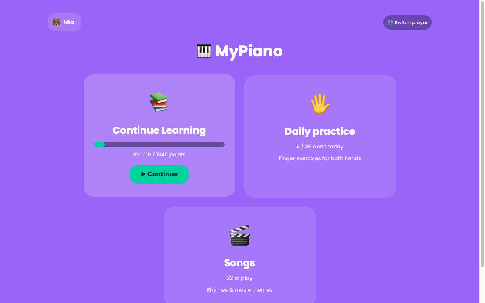 Home |
| 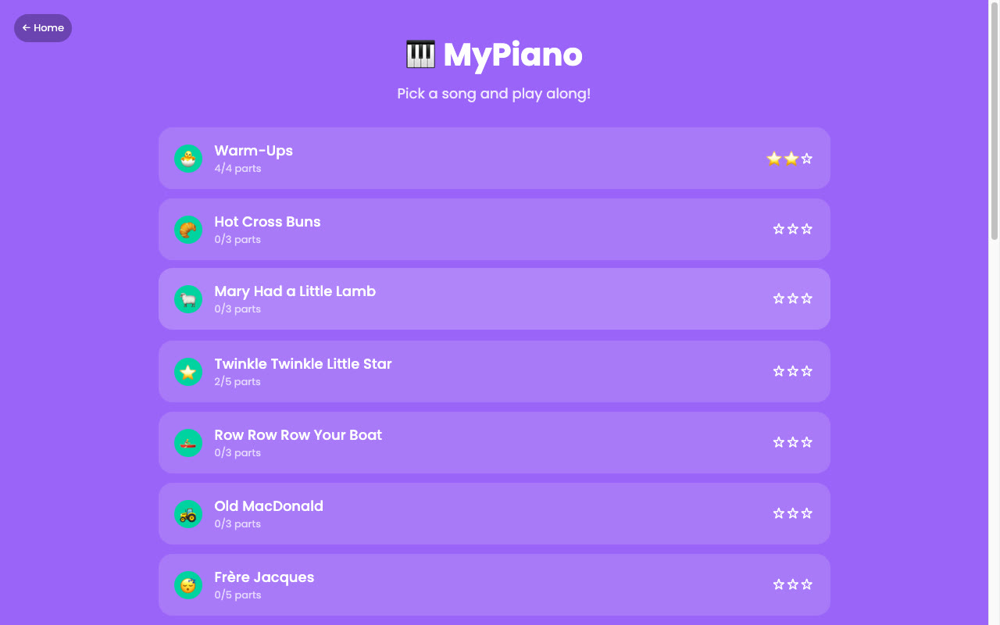 Lessons | 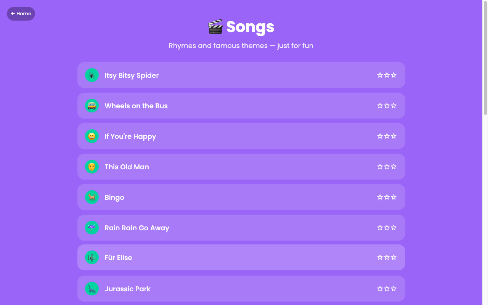 Songs | 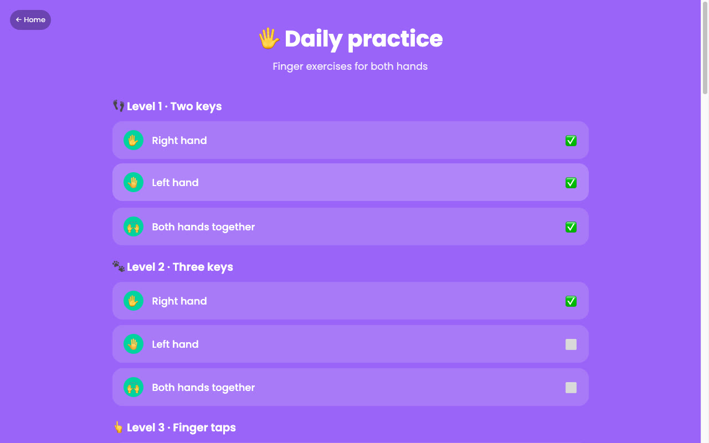 Daily practice |
| 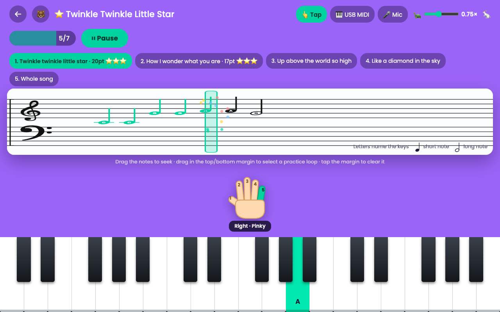 Playing a lesson | 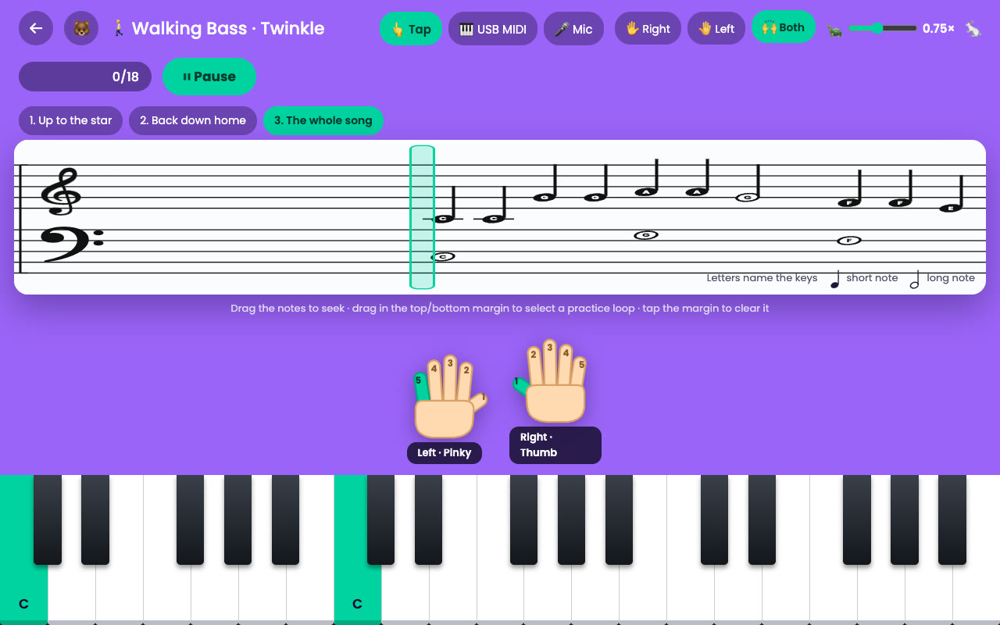 Two hands | 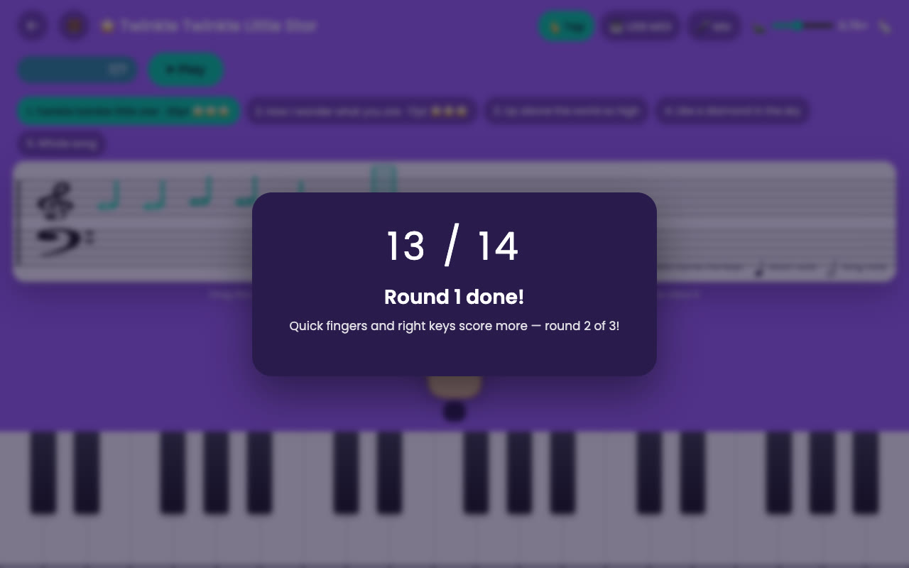 Round score |
| 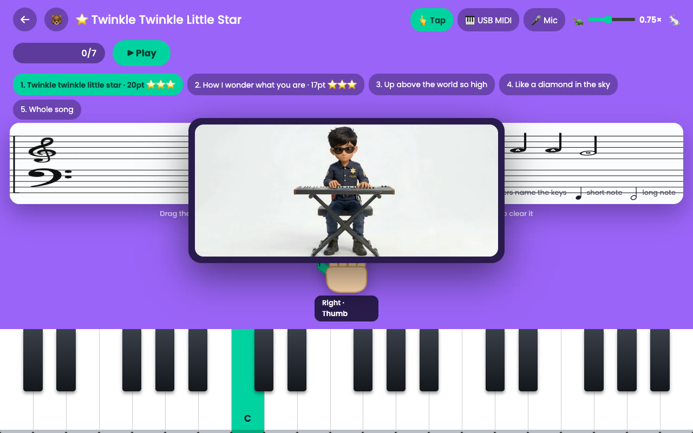 Coach video | 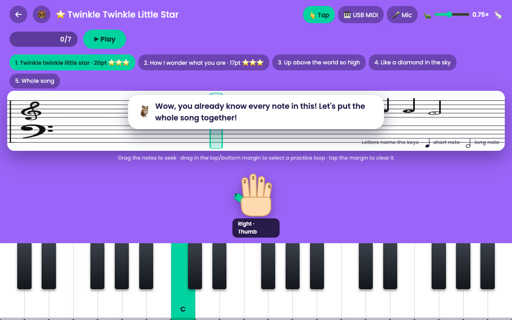 Tutor | 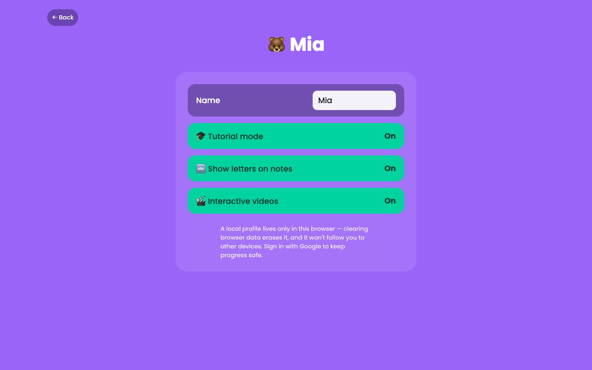 Profile settings |

## What's inside

- **Play your way:** 🎤 mic with a real piano, 🎹 USB-MIDI keyboard, or 👆 tap the on-screen keys.
- **Lessons:** a guided path from Middle C to two-hand pieces, with up to three stars per part.
- **Songs:** nursery rhymes and famous themes, played just for fun.
- **Daily practice:** finger exercises for each hand and both together.
- **Help along the way:** a coach character, a tutor that demos new notes, a finger guide, and a speed slider.
- **Players:** several profiles per browser, with optional Google sign-in to sync progress.

## Host your own

Want your own copy on GitHub Pages? Fork **[My-Piano](https://github.com/SriharshaShesham/My-Piano)** and follow its README section [Host your own copy on GitHub Pages](https://github.com/SriharshaShesham/My-Piano#host-your-own-copy-on-github-pages).

---

This README is generated from the [My-Piano](https://github.com/SriharshaShesham/My-Piano) repo on every deploy, so edits made here are overwritten.
